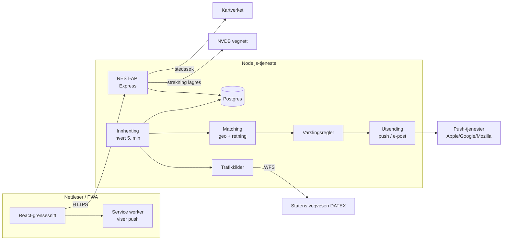

# Køvarsel

Køvarsel er en mobilvennlig webapp (PWA) som følger med på veistrekningene dine i Trøndelag. Den varsler om kø, vesentlige forsinkelser og stengte veger. Overvåkingen går på serveren, så du får varsler selv når appen er lukket.

> **Status:** Første fungerende versjon (MVP) til personlig bruk. Den henter **ekte data fra Statens vegvesen** (åpent og gratis). Utsending av varsler står som standard i **testmodus**: push og e-post sendes ikke før du selv slår det på.

## Innhold

- [Hva fungerer, hva er demo, hva krever tilgang](#status-oversikt)
- [Kom i gang lokalt](#kom-i-gang-lokalt)
- [Tester](#tester)
- [Slik er appen bygd opp](#slik-er-appen-bygd-opp)
- [Aktivere ekte varsler](#aktivere-ekte-varsler)
- [Drift i Google Cloud](docs/drift-gcp.md) · [Utrulling av nye funksjoner](docs/drift-gcp.md#utrulling-av-nye-funksjoner)
- Mer dokumentasjon: [arkitektur](docs/arkitektur.md) · [trafikkilder](docs/trafikkilder.md) · [varslingslogikk](docs/varsling.md)

## Status-oversikt

| Del | Status |
| --- | --- |
| Lister, strekninger valgt i kart, start/slutt, retning, pause og tidsrom (Europe/Oslo) | Fungerer |
| Varig lagring (Postgres; PGlite lokalt) med migreringer | Fungerer |
| Trafikkmeldinger fra Statens vegvesen (DATEX II, åpen WFS) | **Ekte data**, fungerer uten nøkkel |
| Målte reisetider fra Statens vegvesen (forsinkelse i minutter) | **Ekte data**, men bare der Vegvesenet måler (26 delstrekninger rundt Trondheim) |
| Vegens geometri fra NVDB, stedssøk og kart fra Kartverket | **Ekte data**, åpent |
| Geografisk og retningsbestemt matching | Fungerer, testet mot ekte E6-geometri |
| Varslingsregler (duplikater, endringer, avsluttet, terskel, tidsrom, pause) | Fungerer, testet |
| Push (Web Push/VAPID) og e-post (SMTP) | Bygd, men **testmodus** (`NOTIFY_MODE=dry-run`). Krever nøkler og at du slår på `live`. |
| Demodata (`TRAFFIC_SOURCES=...,demo`) | **Demo.** Faste eksempelmeldinger på E6 Sluppen–Moholt, merket DEMO overalt |
| Google Maps Routes (estimert forsinkelse på dine strekninger) | **Bygd og testet med simulerte svar.** Krever API-nøkkel og fakturering. Kostnadsvern med tak per dag og måned. Se [trafikkilder](docs/trafikkilder.md#2-google-maps-platform--routes-api-bygd-krever-nøkkel) |
| Politiet (politiloggen) | Ikke bygd. Ingen verifisert, offentlig dokumentert API. Se [trafikkilder](docs/trafikkilder.md) |
| Lokalaviser | Ikke bygd. Se [trafikkilder](docs/trafikkilder.md) |
| Taleassistent (OpenAI) | Ikke bygd. Planlagt som neste steg, se [arkitektur](docs/arkitektur.md#neste-steg-taleassistent) |
| Innlogging | E-post og passord (scrypt), økter i HttpOnly-informasjonskapsel, invitasjoner, endring og tilbakestilling av passord, administrator kan styre brukere |

## Kom i gang lokalt

Du trenger bare Node.js 22 eller nyere. Lokalt brukes **PGlite**, en ekte Postgres som kjører inne i Node, så du trenger verken Docker eller en egen databaseinstallasjon.

```powershell
cd C:\dev\queuenotice
# På denne PC-en er den globale npm for gammel (8.3). Bruk npm som følger med Node:
$npm = "C:\Program Files\nodejs\node_modules\npm\bin\npm-cli.js"
node $npm install
Copy-Item .env.example .env      # tilpass om ønskelig
node $npm run dev                # starter API (8080) og webapp (5173)
```

Åpne <http://localhost:5173>. Databasen lagres i `.data/pglite`, og migreringene kjøres automatisk ved oppstart.

### Første administrator

Det finnes ingen åpen registrering. Lag første bruker fra kommandolinjen. **Stopp appen først**, fordi den lokale databasen ikke tåler å bli åpnet av to prosesser samtidig:

```powershell
node $npm run user -- invite din@epost.no --admin    # skriver ut en invitasjonslenke (48 t)
node $npm run dev                                    # start igjen og åpne lenken
```

Andre kommandoer: `user -- reset <e-post>` (lenke for nytt passord), `user -- rename <gammel> <ny>` (bytt e-post, beholder lister) og `user -- list`. Etterpå kan administrator invitere brukere og lage lenker for nytt passord under **Konto** i appen.

Første gang:

1. Gå til **Lister** og lag en liste, for eksempel «Til jobb».
2. Legg til en strekning: trykk start (A) og slutt (B) i kartet, sjekk at den blå linjen følger vegen du kjører, og velg kjøreretning.
3. Gå til **Oversikt** og trykk **Oppdater nå**. Serveren henter også automatisk hvert 5. minutt.
4. Under **Varsler** velger du kanal og hendelsestyper. Varsler havner i loggen nederst på siden (testmodus).

Nyttige kommandoer:

| Kommando | Hva den gjør |
| --- | --- |
| `node $npm run dev` | Utviklingsserver for API og webapp med automatisk omstart |
| `node $npm test` | Kjører backend-testene |
| `node $npm run typecheck` | TypeScript-sjekk av begge delene |
| `node $npm run build` | Produksjonsbygg (`frontend/dist` og `backend/dist`) |
| `node $npm start` | Starter det bygde produksjonsoppsettet på port 8080 (serverer også webappen) |
| `node $npm run poll` | Kjører én innhenting og avslutter (det Cloud Run Job gjør) |
| `node $npm run db:migrate` | Kjører databasemigreringer mot `DATABASE_URL` |
| `node $npm run transfer -- export/import` | Flytter brukere og lister mellom databaser (se [drift](docs/drift-gcp.md)) |

## Tester

```powershell
node $npm test
```

Testene bruker ingen nettverkstilgang og sender aldri ekte varsler. De dekker:

- **Matching** mot ekte E6-geometri fra NVDB og et utsnitt av ekte Vegvesen-meldinger (`backend/test/fixtures`, hentet 2026-10-15): riktig veg, korridor, start/slutt, retning, kryssende veger og reisetider som svinger av.
- **Tidsrom** i Europe/Oslo, inkludert sommertid/vintertid og tidsrom over midnatt.
- **Varslingsregler**: ingen duplikater, terskel, hysterese, oppdatering ved vesentlig endring, opptrapping, avslutning, kildefeil, tidsrom og pause.
- **Ende til ende**: innhenting → lagring → varsling med demodata og PGlite i minnet, inkludert kildefeil og samtidige kjøringer.
- **API**: validering, CSRF-vern og at push bare godtas til kjente push-tjenester.
- **Postgres-driveren** (`pg`) som brukes mot Cloud SQL, testet mot en lokal PGlite-server: migreringer, innhenting, varsling og innlogging.

## Slik er appen bygd opp



Kort fortalt er det én Node.js-tjeneste med to oppgaver: et API som webappen snakker med, og en innhentingsjobb som hver 5. minutt henter data, finner ut hva som treffer strekningene dine og sender varsler. Alt lagres i Postgres. Se [docs/arkitektur.md](docs/arkitektur.md) for begrunnelser og mappestruktur.

## Aktivere ekte varsler

Ingenting sendes før du gjør dette. Push er gratis; e-post krever en SMTP-konto.

**Push (anbefalt først):**

1. Lag nøkler: `npx web-push generate-vapid-keys`
2. Legg dem i `.env`: `VAPID_PUBLIC_KEY`, `VAPID_PRIVATE_KEY`, `VAPID_SUBJECT=mailto:din@adresse`.
3. Sett `NOTIFY_MODE=live` og start på nytt.
4. Åpne appen, gå til **Varsler**, trykk **Aktiver på denne enheten** og deretter **Send testvarsel**.
   - På **iPhone** må appen først legges til på Hjem-skjermen (Del → Legg til på Hjem-skjerm), og den må åpnes derfra. Krever iOS 16.4 eller nyere.
   - Push krever HTTPS. Unntaket er `localhost` på samme PC. Fra mobilen trenger du derfor drift i skyen eller Tailscale Serve, som i neste-steg.

**E-post:** Fyll ut `SMTP_HOST`, `SMTP_PORT`, `SMTP_USER`, `SMTP_PASS` og `SMTP_FROM` (for eksempel Gmail med app-passord), og sett `NOTIFY_MODE=live`.

Kostnadsvern: `MAX_NOTIFICATIONS_PER_DAY` (standard 40) stopper utsending per bruker per døgn.

## Kildehenvisning

Inneholder data under Norsk lisens for offentlige data (NLOD) tilgjengeliggjort av Statens vegvesen (trafikkmeldinger, reisetider og NVDB). Stedsnavn og adresser kommer fra Kartverket. Bakgrunnskartet er Kartverkets topografiske norgeskart (CC BY 4.0), vist med Leaflet.
