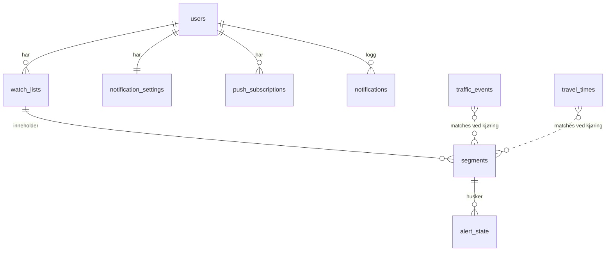

# Arkitektur

## Valg og begrunnelse

| Valg | Hvorfor |
| --- | --- |
| **PWA**, ikke native app | Én kodebase for PC, Android og iPhone, uten app-butikk. Web Push virker på iPhone fra iOS 16.4 når appen er lagt til på Hjem-skjermen. Mikrofon og høyttaler (taleassistent senere) er tilgjengelig i nettleseren over HTTPS. Native app gir bare små fordeler her (litt sikrere push på iPhone), men koster to kodebaser og publisering i app-butikker. |
| **Én Node.js/TypeScript-tjeneste** (Express) som også serverer webappen | Én ting å bygge, deploye og overvåke. Samme språk i frontend og backend. |
| **React + Vite** i frontend | Lite og raskt oppsett, og kjent fra neste-steg. Ingen tung ruter: fem sider med `#`-adresser. |
| **Postgres med ren SQL** (`pg`), ingen ORM | Du ser nøyaktig hvilke spørringer som kjøres, og det er lett å lære. Migreringer er nummererte `.sql`-filer. |
| **PGlite** lokalt og i tester | Ekte Postgres i Node-prosessen. Ingen Docker eller installasjon, og samme SQL som i drift. |
| **Innhenting som egen jobb** | Overvåkingen er uavhengig av nettleseren. I skyen kjører Cloud Scheduler en Cloud Run Job hvert 5. minutt. Lokalt brukes en enkel timer. |
| **Ren funksjon for varslingsregler** | Reglene (`evaluateAlerts`) har ingen database- eller nettverkskall, så de kan testes grundig. |
| **Google IAP** for innlogging i drift | Ingen passordkode i appen. Bare din Google-konto slipper inn. Støtter flere brukere senere, fordi hver e-post blir en egen bruker. |

## Mappestruktur

```text
backend/
  migrations/           SQL-migreringer (001_init.sql …)
  src/
    domain/             Ren logikk uten I/O: typer, geo, tidsrom, matching, regler, status, tekster
    traffic/            Integrasjoner: Vegvesen WFS, demo, NVDB, Kartverket, HTTP med gjenforsøk
    services/           repo.ts (all SQL), analyze.ts, poll.ts, notifier.ts, overview.ts
    routes/             REST-API (lister, strekninger, innstillinger, push, oversikt)
    middleware/         Innlogging (dev/IAP), CSRF-header, sikkerhetsheadere, rate limit, feil
    jobs/               scheduler.ts (lokal timer) og pollOnce.ts (Cloud Run Job)
    db/                 Tilkobling (pg / PGlite) og migreringskjører
  test/                 Vitest-tester og ekte testdata (fixtures)
frontend/
  public/               manifest, ikoner, service worker (sw.js)
  src/
    api/client.ts       Typer og fetch mot API-et
    pages/              Oversikt, Lister, Liste, Varsler, Om data
    components/         Stedsvelger, tidsromseditor, strekningsskjema
```

## Dataflyt i én innhenting (`services/poll.ts`)

1. **Lås:** En tidsbegrenset lås i databasen (`poll_lock`) hindrer at to innhentinger kjører samtidig.
2. **Hent:** Hver kilde leverer et komplett øyeblikksbilde for Trøndelag (`TrafficSource.fetchSnapshot`). Kildene hentes parallelt, og én kildes feil stopper ikke de andre.
3. **Lagre:** Hendelser og reisetider lagres (upsert). Det som ikke lenger finnes i kilden, merkes `gone`. Kildestatus (`source_status`) registrerer tid for siste vellykkede henting og eventuell feil.
4. **Retning:** For nye eller endrede meldinger som treffer en strekning, slås berørt kjøreretning opp i den fullstendige DATEX-meldingen. Oppslaget gjøres én gang per versjon og har et tak per runde.
5. **Analyse per strekning** (`analyze.ts`): matching, aktivitet (aktiv, planlagt eller utløpt), deduplisering og status.
6. **Regler** (`domain/alertRules.ts`): sammenligner med `alert_state` og bestemmer `new`, `update` eller `resolved`.
7. **Utsending** (`notifier.ts`): push og/eller e-post, eller bare logg i testmodus. Alt føres i `notifications`.
8. **Rydding:** Gamle data slettes (hendelser etter 7 dager, varslingslogg etter 90 dager).

## Datamodell (forenklet)



- `watch_lists.schedule` er en JSON-liste med tidsrom (`days`, `from`, `to`).
- `segments.geometry` er vegens linje (`[[lon,lat],…]`) fra NVDB, eller rett linje som reserve.
- Matching lagres ikke. Den beregnes på nytt hver gang, slik at endringer i strekninger gjelder umiddelbart.

## Geografisk matching (`domain/matching.ts`)

- **Veinummer alene gir aldri treff.** Strekningen er vegens geometri mellom start og slutt, og en melding må ligge innenfor en korridor rundt den. Standard korridor er 300 m.
- **Riktig veg:** Hvis meldingen oppgir veinummer, må det være ett av vegnumrene strekningen følger. Det hindrer treff på kryssende veger og bruer. Meldinger uten veinummer må ligge innenfor 75 m.
- **Vegnumre fra ruten:** Brukeren velger bare A og B i kartet. Punktene festes til nærmeste europa-, riks- eller fylkesveg (NVDB, maks 200 m). Ligger begge på samme veg, følges den; ellers korteste vei på E/R/F-veger. Vegnumre ruten følger i minst 300 m lagres på strekningen.
- **Retning:** Strekningen har en retning (start → slutt). Gjelder meldingen begge retninger, er den relevant uansett. Gjelder den bare én retning, sammenlignes rekkefølgen på punktene i meldingens linje med retningen på strekningen. Mangler retningsinformasjon, merkes meldingen «retning ikke oppgitt», og innstillingen din bestemmer om du skal varsles.
- **Reisetider** må overlappe minst 80 % av den korteste av linjene og gå i riktig retning. Da tas ikke målinger med som svinger av til andre veger.
- Geometrien beregnes i en lokal flat projeksjon i meter. Det er nøyaktig nok for strekninger på noen titalls kilometer.

## Sikkerhet og personvern

- **Innlogging:** e-post og passord. Passord hashes med scrypt (N=2^17, r=8, p=1, OWASP-anbefaling) og må ha minst 12 tegn. Økten ligger i en `HttpOnly`, `SameSite=Lax` informasjonskapsel (`Secure` over HTTPS); databasen lagrer bare SHA-256 av økt-tokenet. Økter varer 30 dager og forlenges ved bruk.
- **Ingen åpen registrering:** nye brukere kommer inn via invitasjonslenke (48 t, én gang). Lenker for nytt passord varer 30 min. Tokenet ligger etter `#` i lenken og havner derfor ikke i serverlogger.
- **Endring av passord** krever nåværende passord og logger ut alle andre enheter. Tilbakestilling logger ut alle enheter.
- **Glemt passord** sender lenke på e-post når SMTP er satt opp og `NOTIFY_MODE=live`; svaret er det samme uansett om adressen finnes. Ellers lager administrator lenken.
- **Brute force:** maks 5 mislykkede innlogginger per konto og IP per 15 min, og 20 per IP. Ukjente e-poster sjekkes mot et dummy-passord slik at svartiden ikke avslører hvilke brukere som finnes.
- Hemmeligheter (VAPID-privatnøkkel, SMTP-passord, database-passord) ligger bare i miljøvariabler lokalt og i **Secret Manager** i drift. De sendes aldri til nettleseren.
- Logger skjuler e-postadresser og push-endepunkter (`redact` i `logger.ts`). Ruter og e-post er bare synlige for eieren, og alle SQL-spørringer filtrerer på `user_id`.
- Endrende kall krever headeren `x-kv-client`, som gir enkel CSRF-beskyttelse. Strenge sikkerhetsheadere (CSP med mer) settes på alle svar.
- Push-abonnement godtas bare mot kjente push-tjenester. Det hindrer at serveren kan brukes til å kontakte vilkårlige adresser (SSRF).
- `AUTH_MODE=dev` stoppes i produksjon (`NODE_ENV=production`).

## Kostnadskontroll

- Vegvesenet, NVDB og Kartverket er gratis. Det gjøres 2 kall per 5. minutt (≈ 17 000 per måned), pluss noen få retningsoppslag.
- Kartet i strekningsskjemaet henter kartfliser direkte fra Kartverket i nettleseren (ingen last på serveren). Et trykk i kartet gir ett NVDB-kall (feste punktet til vegen) og ett stedsnavnkall; forhåndsvisningen bruker samme NVDB-ruting som ved lagring.
- NVDB kalles bare når en strekning lagres eller endres.
- Varsler har et tak per døgn (`MAX_NOTIFICATIONS_PER_DAY`), og Web Push er gratis.
- «Oppdater nå» er begrenset til én gang i minuttet per bruker.

## Neste steg: taleassistent

Planen følger mønsteret fra neste-steg (OpenAI Realtime over WebRTC):

1. Serveren lager en kortlivet klientnøkkel. API-nøkkelen forblir på serveren, i Secret Manager.
2. Assistenten får verktøy som `prepare_segment_draft` («overvåk E6 fra Melhus til Tonstad på hverdager 07–08»). Verktøyet fyller bare ut skjemaet, og du bekrefter selv før noe lagres.
3. Opplesing av varsler: nettleserens `speechSynthesis` med norsk stemme (gratis), eventuelt OpenAI TTS som tillegg.
4. Kostnadsvern: grense for antall økter per minutt, maks varighet per økt, og forbruksgrense i OpenAI Platform.
